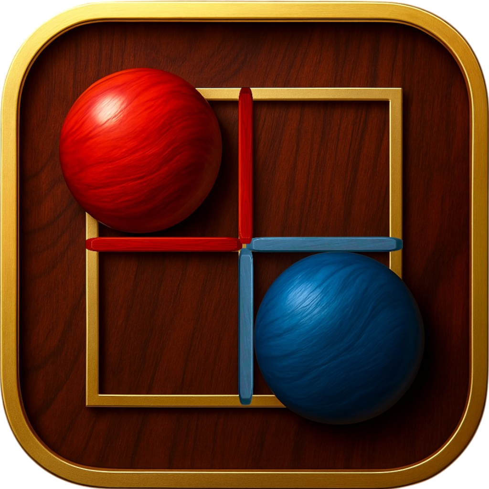

# 벽바둑 · WallBaduk

벽바둑은 7×7 보드에서 말을 움직이고 벽을 세워 영역을 확보하는 2인 전략 보드게임입니다. 양쪽 말의 영역이 완전히 분리되면 게임이 끝나며, 더 넓은 영역을 확보한 쪽이 승리합니다.

**WallBaduk-App**은 벽바둑 앱과 게임 AI를 관리하는 GitHub 조직입니다.

| Repository | 내용 |
|---|---|
| WallBadukApp | Android·iOS용 Flutter 앱 · 비공개 |
| [WallBadukAI](https://github.com/WallBaduk-App/WallBadukAI) | 순수 Dart 규칙·봇 탐색·정책/가치망 추론과 Python v2/v3 PPO 학습 코드 · 공개 |

WallBadukAI에는 실제 사용자 기보를 포함하지 않습니다. 실행 방법, 모델 정보와 실험 범위는 저장소의 README에서 확인할 수 있습니다. 학습 실행의 완료는 수렴이나 기력 향상을 의미하지 않습니다.
